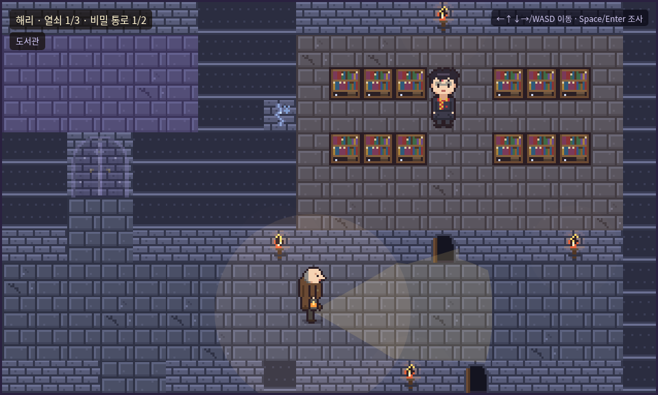

# 호그와트 탐험

해리 포터 세계관의 호그와트 성을 탐험하는 브라우저 픽셀 게임입니다. (Phaser 3, 정적 HTML)

▶ 플레이: https://azer-official.github.io/hogwarts-explore/

## 조작법
- **방향키 / WASD**: 이동
- **Space / Enter**: 조사·대화
- **Backspace / ←**: 이전 대사

## 목표
필치와 미세스 노리스의 눈을 피해 성 곳곳에 숨겨진 **열쇠 3개**를 모아 **필요의 방**을 여세요.
들키면 휴게실로 돌아갑니다. (진행 상황은 자동 저장, `?reset=1` 로 초기화)

## 안내
이 게임은 비상업적 팬 게임입니다. 해리 포터 및 관련 명칭·캐릭터의 권리는 각 권리자에게 있으며, 공식 작품과 관련이 없습니다.
